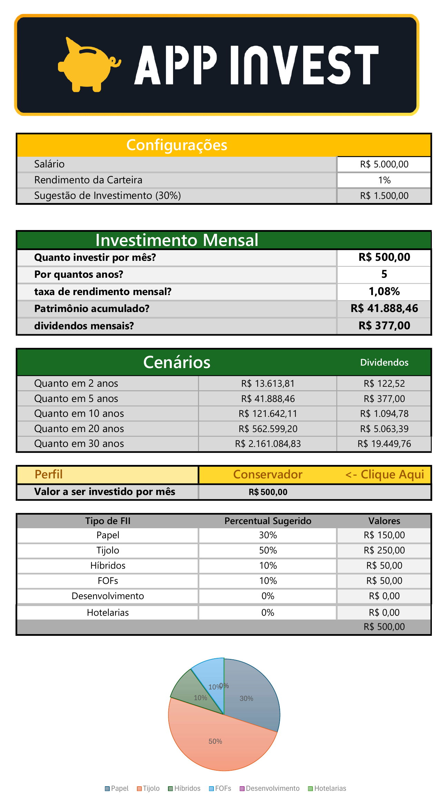

<p align="center">
  
</p>

<h1 align="center">APP INVEST — Simulador de Investimentos em Fundos Imobiliários (FIIs)</h1>

<p align="center">
  Ferramenta interativa construída no <strong>Microsoft Excel</strong> com visual de aplicativo para simular aportes mensais, projeção de patrimônio de longo prazo, dividendos mensais e alocação automática por perfil de investidor com gráfico dinâmico.
</p>

<p align="center">
  
  
  
  
</p>

---

## Sobre o Projeto

O **APP INVEST** foi desenvolvido como desafio prático da **Digital Innovation One (DIO)** focado em Microsoft Excel aplicado a finanças pessoais e análise de negócios. O objetivo foi transformar uma planilha comum em uma ferramenta intuitiva, com "cara de aplicativo", na qual qualquer pessoa consegue simular sua jornada em Fundos Imobiliários (FIIs) sem precisar conhecer nenhuma fórmula por trás dos cálculos.

Para garantir segurança e boa experiência de uso:
- As **linhas de grade** foram ocultadas para oferecer uma interface limpa;
- As **células editáveis** ficam visualmente separadas das **células calculadas** (destacadas em cinza para evitar alterações acidentais);
- O campo de seleção de perfil conta com indicação visual (`<- Clique Aqui`) e **Validação de Dados**;
- Toda a lógica é guiada por **Intervalos Nomeados**, **Referências Absolutas**, uma **aba de apoio** com chave composta e um **Gráfico de Pizza** que se atualiza automaticamente ao trocar o perfil.

---

## 1. As 5 Perguntas de Negócio que a Ferramenta Responde

Antes de construir qualquer fórmula, a ferramenta foi desenhada para responder de forma direta às cinco perguntas essenciais de quem deseja investir em FIIs:

| # | Pergunta de Negócio | Tipo de Campo | Onde Aparece na Planilha |
| :---: | :--- | :--- | :--- |
| **1** | **Quanto investir por mês?** | Entrada do usuário (editável) | Seção **Investimento Mensal** (com apoio da **Sugestão de Investimento de 30%** do salário em Configurações) |
| **2** | **Por quantos anos?** | Entrada do usuário (editável) | Seção **Investimento Mensal** — campo `Por quantos anos?` |
| **3** | **Qual a taxa de rendimento mensal?** | Entrada do usuário (editável) | Seção **Investimento Mensal** — campo `taxa de rendimento mensal?` (além do `Rendimento da Carteira` em Configurações) |
| **4** | **Quanto de patrimônio vai acumular?** | Calculado (célula cinza) | Seção **Investimento Mensal** (`Patrimônio acumulado?`) e tabela **Cenários (2, 5, 10, 20 e 30 anos)** |
| **5** | **Quanto vai receber de dividendos por mês?** | Calculado (célula cinza) | Seção **Investimento Mensal** (`dividendos mensais?`) e coluna **Dividendos** nos **Cenários** |

---

## 2. Como as Funções `VF` e `PROCV` Entram nos Cálculos

### Função `VF` (Valor Futuro) — Cálculo do Patrimônio e Cenários
Para projetar o acúmulo de patrimônio com juros compostos e aportes mensais constantes, foi utilizada a função financeira `VF`:

```excel
=VF(taxa_mensal; tempo_anos * 12; -aporte)
```

- **`taxa_mensal`**: taxa de rendimento mensal informada na simulação (no exemplo publicado, `1,08%` a.m.).
- **`tempo_anos * 12`**: converte o prazo informado em anos para o total de meses (`nper`), mantendo a mesma unidade da taxa mensal.
- **`-aporte`**: valor investido por mês (`pgto`), inserido com sinal negativo para representar saída de caixa e retornar o patrimônio futuro como valor positivo.

A partir do patrimônio acumulado, os **dividendos mensais** são estimados com base na taxa de rendimento da carteira definida em **Configurações**.

Nos **Cenários (2, 5, 10, 20 e 30 anos)**, o cálculo de `VF` é replicado usando **referências absolutas (`$`)** e **intervalos nomeados**, permitindo arrastar a fórmula com segurança sem perder as referências originais.

---

### Função `PROCV` com Chave Composta — Divisão por Perfil de Investidor
Para distribuir automaticamente o valor do aporte mensal entre os **6 tipos de Fundos Imobiliários** conforme o perfil escolhido na lista suspensa (`Perfil`), foi estruturada uma **aba de apoio** com 4 colunas (`Chave`, `Perfil`, `Tipo de FII`, `Percentual`):

1. Na primeira coluna da aba de apoio (`Chave`), uma fórmula concatena o **Perfil** e o **Tipo de FII** separados por hífen (`-`):
   ```excel
   =B2 & "-" & C2
   ```
   Exemplos de chaves geradas na tabela de apoio: `Conservador-Tijolo`, `Moderado-Papel`, `Moderado-Tijolo`, `Agressivo-Desenvolvimento`, `Agressivo-Hotelarias`.

2. Na tela principal, o `PROCV` monta essa mesma chave composta a partir do perfil selecionado e busca o percentual na **4ª coluna** da tabela de apoio com correspondência exata (`FALSO` / `0`):
   ```excel
   =PROCV(perfil & "-" & A24; Tabela_Perfis; 4; FALSO)
   ```
   *(A referência da linha de cada tipo de FII acompanha a posição da tabela na tela principal).*

3. Por fim, a coluna **Valores** multiplica o aporte mensal pelo percentual retornado (`=aporte * percentual`), atualizando simultaneamente o resumo em reais e o **Gráfico de Pizza** da carteira.

---

## 3. Intervalos Nomeados Criados

Para deixar as fórmulas mais legíveis, fáceis de manter e orientadas ao negócio, foram utilizados **Intervalos Nomeados** no Gerenciador de Nomes do Excel:

| Intervalo Nomeado | Finalidade na Ferramenta |
| :--- | :--- |
| `salario` | Salário mensal fictício informado em Configurações (`R$ 5.000,00`) |
| `rendimento_carteira` | Percentual de rendimento da carteira usado na estimativa dos dividendos (`1%`) |
| `sugestao_investimento` | Sugestão automática de aporte mensal equivalente a `30%` do salário (`R$ 1.500,00`) |
| `aporte` | Valor mensal utilizado na simulação (`R$ 500,00`) e na divisão por FIIs |
| `taxa_mensal` | Taxa de rendimento mensal aplicada na função `VF` (`1,08%`) |
| `tempo_anos` | Horizonte de investimento em anos da simulação principal (`5 anos`) |
| `perfil` | Perfil de investidor selecionado na lista suspensa (Validação de Dados) |

> **Nota:** Caso algum nome no Gerenciador de Nomes (`Ctrl + F3`) do arquivo esteja com grafia diferente, basta manter os nomes sincronizados com esta tabela.

---

## 4. Perfis de Investidor e Percentuais de Alocação

A divisão do aporte mensal contempla **6 tipos de Fundos Imobiliários** e muda automaticamente ao alternar o perfil na lista suspensa. Em todos os perfis, a soma das alocações fecha exatamente em **100%**:

| Tipo de FII | Conservador | Moderado | Agressivo |
| :--- | :---: | :---: | :---: |
| **Papel** | 30% | 32% | 50% |
| **Tijolo** | 50% | 35% | 10% |
| **Híbridos** | 10% | 8% | 5% |
| **FOFs** | 10% | 5% | 5% |
| **Desenvolvimento** | 0% | 10% | 20% |
| **Hotelarias** | 0% | 10% | 10% |
| **Total** | **100%** | **100%** | **100%** |

> **De onde vieram os percentuais?**  
> Os percentuais foram estruturados exclusivamente com **fins didáticos e de simulação**, refletindo uma progressão clara de apetite ao risco entre os três perfis:
> - **Conservador:** concentra 80% em fundos tradicionais de Tijolo (50%) e Papel (30%), complementados por Híbridos (10%) e FOFs (10%), sem exposição a Desenvolvimento (0%) e Hotelarias (0%);
> - **Moderado:** equilibra Tijolo (35%) e Papel (32%) com exposição controlada a Desenvolvimento (10%), Hotelarias (10%), Híbridos (8%) e FOFs (5%);
> - **Agressivo:** prioriza maior potencial de retorno e risco, concentrando 50% em Papel, 20% em Desenvolvimento e 10% em Hotelarias, reduzindo Tijolo (10%), Híbridos (5%) e FOFs (5%).
>
> **Estes percentuais são apenas exemplos educacionais e não constituem recomendação de investimento.**

---

## 5. O Que Foi Diferenciado em Relação à Ferramenta do Expert

Para tornar o projeto autoral e pronto para portfólio, foram adicionados os seguintes diferenciais sobre a estrutura base das aulas:

- **Identidade Visual Própria (`APP INVEST`):** Criação de nome e banner exclusivos em paleta escura com destaque dourado, substituindo a marca original do curso e harmonizando com os cabeçalhos da planilha.
- **Gráfico de Pizza Dinâmico:** Adição de um gráfico de pizza conectado à tabela de alocação por FII, que se redesenha automaticamente sempre que o usuário altera o perfil na lista suspensa (uma das evoluções propostas no desafio).
- **Indicador de Usabilidade (`<- Clique Aqui`):** Destaque visual ao lado da célula com Validação de Dados para orientar quem abre a ferramenta pela primeira vez.
- **Cenários Completos com Dividendos:** Projeção paralela de patrimônio acumulado e renda mensal estimada em dividendos para horizontes de 2, 5, 10, 20 e 30 anos.
- **Dados Fictícios de Exemplo:** Valores demonstrativos (`R$ 5.000,00` de salário e `R$ 500,00` de aporte) para permitir testes imediatos preservando informações pessoais.

---

## 6. Demonstração da Ferramenta (Mesma Simulação em Dois Perfis)

Para comprovar o funcionamento dinâmico da planilha, a mesma simulação base foi executada alterando **apenas o Perfil de Investidor**:

- **Configurações:** Salário de `R$ 5.000,00` | Rendimento da Carteira: `1%` | Sugestão de 30%: `R$ 1.500,00`
- **Simulação:** Aporte mensal de `R$ 500,00` | Prazo de `5 anos` | Taxa mensal de `1,08%`
- **Resultados Projetados (5 anos):** Patrimônio acumulado de **`R$ 41.888,46`** e dividendos mensais estimados de **`R$ 377,00`**
- **Projeção de Longo Prazo (Cenários):** de **`R$ 13.613,81`** (2 anos) até **`R$ 2.161.084,83`** em patrimônio e **`R$ 19.449,76/mês`** em dividendos (30 anos)

### Simulação no Perfil Conservador
Alocação de `R$ 500,00`: **Tijolo** (`50%` — `R$ 250,00`), **Papel** (`30%` — `R$ 150,00`), **Híbridos** (`10%` — `R$ 50,00`), **FOFs** (`10%` — `R$ 50,00`), **Desenvolvimento** (`0%`) e **Hotelarias** (`0%`).



### Simulação no Perfil Agressivo
Alocação de `R$ 500,00`: **Papel** (`50%` — `R$ 250,00`), **Desenvolvimento** (`20%` — `R$ 100,00`), **Tijolo** (`10%` — `R$ 50,00`), **Hotelarias** (`10%` — `R$ 50,00`), **Híbridos** (`5%` — `R$ 25,00`) e **FOFs** (`5%` — `R$ 25,00`).


---

## Como Utilizar a Planilha

1. Faça o download do arquivo `app-invest-simulador-fii.xlsx` presente neste repositório.
2. Abra o arquivo no **Microsoft Excel**.
3. Em **Configurações**, ajuste o salário de exemplo e o rendimento da carteira, se desejar.
4. Em **Investimento Mensal**, informe quanto deseja investir por mês, por quantos anos e a taxa de rendimento mensal.
5. Em **Perfil**, clique na lista suspensa (`<- Clique Aqui`) e alterne entre **Conservador**, **Moderado** e **Agressivo** para ver a tabela de FIIs e o gráfico de pizza se atualizarem automaticamente.

---

## Aviso Legal

Este projeto tem caráter estritamente **educacional e demonstrativo**. Os valores inseridos na planilha são fictícios e os percentuais por perfil não representam recomendação de compra, venda ou alocação de ativos financeiros.

---

## Autor

Desenvolvido por **Diego Floriano Costa** como projeto prático da **Digital Innovation One (DIO)**.